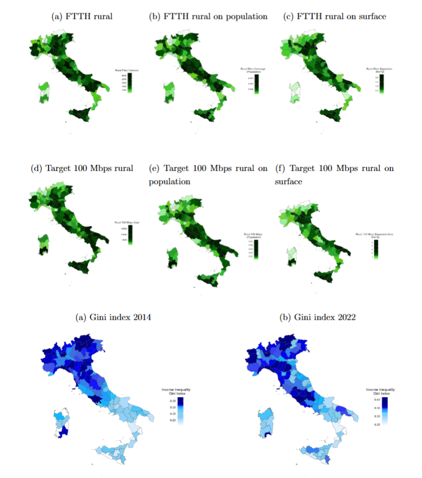
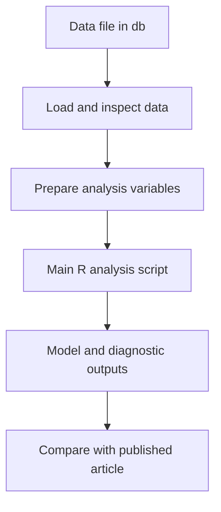

# Digital Divide and Income Inequality — Replication Package

<p align="center">
  
</p>

*two Gini index maps (2014 and 2022) and three broadband-coverage maps, displayed together*

Research article: **Digital divide and income inequality: causal evidence from Italian provinces**


## Overview

The study examines provincial digital divides and income inequality in Italy, using a longitudinal empirical framework. The five-panel cover brings together two Gini maps and three measures of rural 100 Mbps coverage.

This repository publishes the principal R material available for the empirical workflow, accompanying data material, and a representative figure. It does not include the complete collection of data-construction and exploratory scripts.

## Empirical approach

The original main analysis script covers econometric and descriptive work involving provincial data. Spatial clustering, inequality outcomes, and broadband variables are represented in the authors’ supporting figures.

## Replication workflow



## Repository structure

```text
Digital-Divide-and-Income-Inequality/
  README.md
  cover.png
  code/
    00_check_data.R
    01_main_analysis_original.R
  db/
    pdata.rds
```

## Data and availability

The supplied `db/pdata.rds` is included as received from the author. The raw data are described as drawn from public sources; users should consult the article for original sourcing and definitions.

This repository does **not** include `meta_fusco.xlsx`, which the original analysis script requests, nor any spatial boundary files or additional input data referenced by the full workflow. The single original script is supplied for transparency, **not as a verified standalone executable**.

## Main scripts and instructions

To inspect the provided dataset from the project root:

```r
source("code/00_check_data.R")
```

`code/01_main_analysis_original.R` preserves the main analysis file from the uploaded `clustering.zip` working archive. It relies on a local path for `pdata.rds` and the external metadata workbook. Replace those paths with `db/pdata.rds` and an accessible `meta_fusco.xlsx` before running it. Extensive additional methods and supporting scripts are available on request.

## Representative figure

`cover.png` shows two Gini index maps (2014 and 2022) and three broadband-coverage maps, displayed together. The figure is provided for visual orientation; the original figure files are not needed to execute the statistical code.

## Software and reproducibility

The empirical code uses **R**. Install the packages referenced at the top of each script. The scripts were collected from the authors' working archives; their execution against the shared data files has **not been fully verified** in this release. Source files requiring external metadata, shapefiles, or complete input panels cannot be expected to run from this repository alone.

The article is the authoritative source for reported estimates, confidence intervals, and interpretations. Reduced or simulated databases should not be used to reproduce published numerical results.

## Additional code availability

The full set of coding files and further implementation details are available from the authors upon reasonable request, **subject to applicable confidentiality and data-sharing restrictions**.

