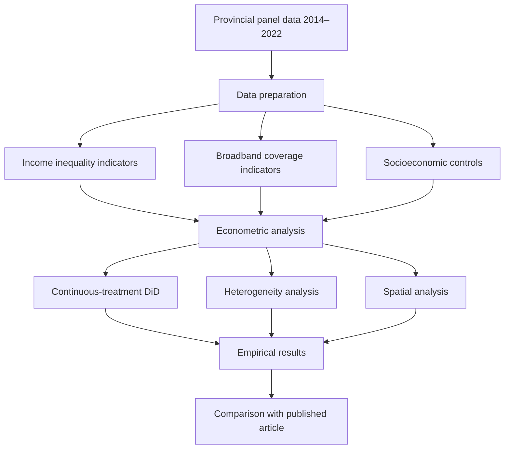

# Digital Divide and Income Inequality — Replication Package

<p align="center">
  
</p>

*Spatial distribution of income inequality and rural broadband coverage across Italian provinces. The figure combines Gini index maps for 2014 and 2022 with three indicators of rural broadband coverage.*

Replication material accompanying the research article:

**Digital divide and income inequality: causal evidence from Italian provinces**

**Authors:** Angela Stefania Bergantino, Giulio Fusco, Mario Intini, and Gianluca Monturano

**Published in:** *The Annals of Regional Science*, Volume 75, Article 11 (2026).

**Published article:** https://link.springer.com/article/10.1007/s00168-025-01440-z

**DOI:** https://doi.org/10.1007/s00168-025-01440-z

---

## Overview

This repository provides the main R code, supporting data, and representative graphical material associated with the empirical analysis presented in the paper.

The study investigates the relationship between digital infrastructure expansion and income inequality across Italian provinces, with particular attention to the territorial distribution of rural broadband connectivity.

Using a provincial panel dataset covering the period **2014–2022**, the analysis evaluates whether the diffusion of broadband infrastructure contributes to reducing existing socioeconomic disparities or reinforces territorial inequalities.

The empirical investigation focuses on the expansion of broadband connectivity, particularly 30 Mbps and 100 Mbps rural coverage, and its effects on alternative income inequality indicators.

The repository provides the principal empirical coding material rather than the complete collection of data-construction, exploratory, and supplementary analysis scripts.

## Empirical framework

The study adopts a counterfactual Difference-in-Differences (DiD) framework with continuous treatment intensity.

The empirical strategy exploits variation in broadband expansion across Italian provinces following the implementation of national ultra-fast broadband policies.

The main methodological components include:

- **Continuous-treatment Difference-in-Differences:** assessing the relationship between broadband expansion and income inequality.
- **Provincial and year fixed effects:** accounting for unobserved territorial heterogeneity and common temporal shocks.
- **Alternative inequality indicators:** including the Gini, Theil, and Atkinson indices.
- **Heterogeneity analysis:** examining differences across territorial groups, particularly northern and southern provinces and inner areas.
- **Spatial analysis:** investigating the geographical distribution of inequality and potential spatial spillovers.
- **Robustness checks:** evaluating the sensitivity of empirical results to alternative specifications.

The full methodological description and econometric equations are provided in the published article.

## Replication workflow



## Repository structure

```text
Digital-Divide-and-Income-Inequality/
│
├── code/
│   ├── 00_check_data.R
│   └── 01_main_analysis_original.R
│
├── db/
│   └── pdata.rds
│
├── cover.png
│
└── README.md
```

## Data availability

The study relies on provincial-level information obtained from publicly accessible data sources.

The underlying empirical database combines measures of broadband infrastructure, income inequality, and socioeconomic characteristics.

The database construction procedure described in the article is based on publicly available information.

The repository includes the following data file:

```text
db/pdata.rds
```

This file provides the data material supplied for the public repository.

The original analysis script also refers to a metadata workbook:

```text
meta_fusco.xlsx
```

This metadata workbook is not included in the present repository.

Additional data-processing routines, spatial boundary files, and supplementary implementation materials may be required to reproduce the complete empirical workflow.

Further information regarding the construction of the database and the original data sources is available from the authors upon reasonable request.

## Main R scripts

### `code/00_check_data.R`

Provides basic procedures for inspecting the supplied dataset and checking its structure.

The script can be used to examine variable names, data types, and general dataset characteristics.

### `code/01_main_analysis_original.R`

Contains the principal analysis script selected from the authors' working code.

The original script relies on additional metadata and local file paths that may require adjustment before execution.

The publicly distributed script provides access to the main analytical structure but should not be interpreted as a fully verified standalone replication of every published result.

## How to run

Download or clone the repository and open its root directory in R or RStudio.

To inspect the provided data:

```r
source("code/00_check_data.R")
```

The supplied database can also be loaded directly:

```r
pdata <- readRDS("db/pdata.rds")
```

To inspect its structure:

```r
str(pdata)
names(pdata)
summary(pdata)
```

The main analysis script is available at:

```text
code/01_main_analysis_original.R
```

Before running the complete empirical analysis, users should ensure that the required metadata, supplementary inputs, and software dependencies are available.

## Representative figure

The repository includes:

```text
cover.png
```

The figure combines five thematic maps illustrating the spatial distribution of income inequality and broadband infrastructure across Italian provinces.

The maps represent:

1. Provincial Gini index in 2014.
2. Provincial Gini index in 2022.
3. Rural 100 Mbps broadband coverage measured using population.
4. Rural 100 Mbps broadband coverage measured using geographical area.
5. An additional measure of rural 100 Mbps broadband diffusion.

The figure provides a visual overview of the territorial heterogeneity motivating the empirical investigation.

## Software requirements

The empirical analysis was developed entirely in **R**.

The original scripts use packages for:

- Data manipulation and transformation.
- Panel-data econometrics.
- Difference-in-Differences estimation.
- Spatial econometric analysis.
- Statistical reporting and visualization.
- Reading external metadata and supporting datasets.

Users should install the dependencies specified in the individual scripts.

The execution of the complete empirical workflow has not been fully verified using only the files included in this repository.

## Replication outputs

The empirical framework is designed to generate the estimation results associated with the models discussed in the article.

Depending on the specification and the availability of the required input files, the analysis may produce:

- Regression coefficients and standard errors.
- Alternative Difference-in-Differences estimates.
- Heterogeneity results.
- Spatial econometric estimates.
- Diagnostic statistics.
- Supplementary tables and graphical outputs.

The final published estimates and their interpretation should be consulted directly in the research article.

The repository is intended to provide access to the principal coding material and does not redistribute all supplementary analyses.

## Additional code availability

This repository makes available the **main R code associated with the empirical analysis**.

The full set of coding files, including additional data-processing routines, database construction scripts, alternative specifications, spatial analyses, robustness checks, and supplementary implementation details, is available from the authors upon reasonable request, subject to applicable data-sharing restrictions.

## Citation

If you use the code, data structure, or methodological framework provided in this repository, please cite the associated research article:

Bergantino, A. S., Fusco, G., Intini, M., & Monturano, G. (2026).

**Digital divide and income inequality: causal evidence from Italian provinces.**

*The Annals of Regional Science*, 75, Article 11.

https://doi.org/10.1007/s00168-025-01440-z

## Published article

**Journal:** The Annals of Regional Science

**Publisher:** Springer Nature

**Publication year:** 2026

**DOI:** 10.1007/s00168-025-01440-z

**Article:** https://link.springer.com/article/10.1007/s00168-025-01440-z
